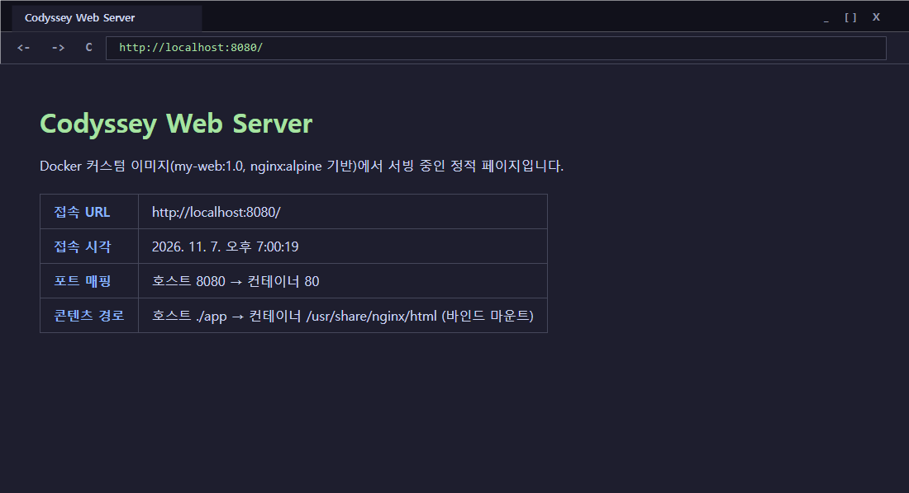
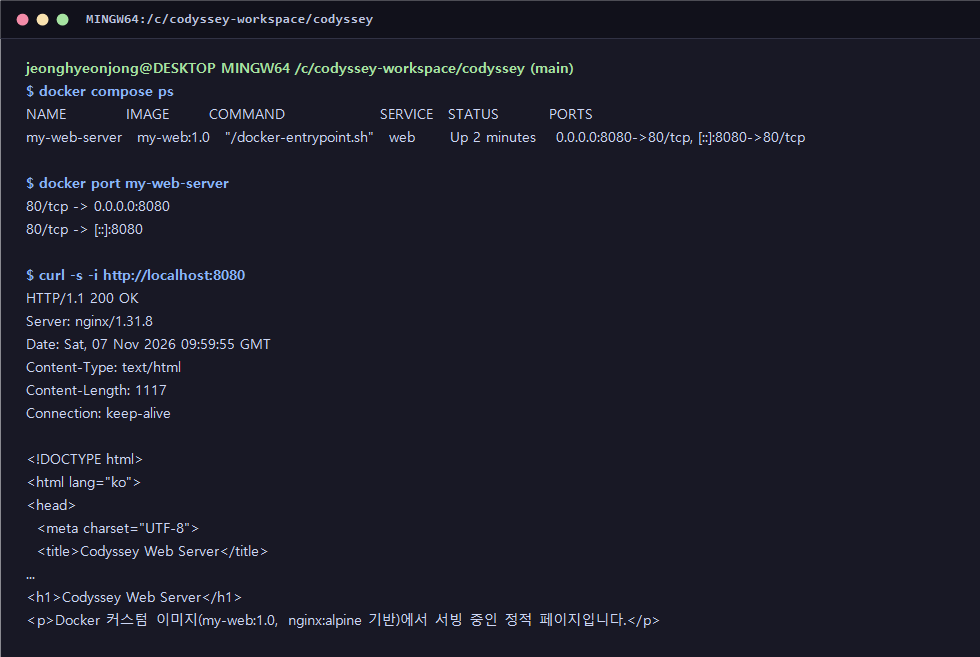

# 개발 워크스테이션 구축 — 터미널 · Docker · Git

Windows 11 노트북에 **터미널 조작 → Docker로 웹 서버 이미지 빌드·실행 → 데이터 영속화 → Git/GitHub 버전 관리**까지 한 흐름으로 구축하고, 각 단계를 실제 명령과 출력으로 남긴 기록입니다.
아래 로그는 모두 이 저장소 폴더에서 직접 실행한 결과를 그대로 옮긴 것이며, 이메일·토큰 같은 민감 정보만 마스킹했습니다.

- 원격 저장소: https://github.com/jeonghyeonjong/codyssey
- 실행 환경: Windows 11 / Git Bash / Docker Desktop 29.9.2 (WSL 2 백엔드) / Git 2.56.0
- 기록 일시: 2026-11-07 (KST)

> 위 화면은 Microsoft Edge로 `http://localhost:8080`을 열어 캡처한 것입니다. 페이지 안의 "접속 URL"과 "접속 시각"은 브라우저가 렌더링 시점에 JavaScript로 채운 값이라, 실제로 그 주소·그 시각에 접속했다는 흔적이 됩니다.

---

## 1. 폴더 구성과 그렇게 나눈 이유

    codyssey/
    ├── Dockerfile        # 이미지 설계도 (nginx:alpine + app/ 복사)
    ├── compose.yaml      # 포트·마운트·볼륨 설정을 파일로 고정 (재현용)
    ├── .gitignore        # 볼륨 백업 파일·임시 실습 파일 제외
    ├── app/
    │   └── index.html    # 웹 서버가 내보내는 정적 페이지
    ├── docs/
    │   ├── localhost_8080.png
    │   └── docker_port_verify.png
    └── README.md

- **빌드 재료와 설정을 루트에 둔다**: `Dockerfile`과 `compose.yaml`이 루트에 있어야 `docker build .`, `docker compose up` 을 저장소 루트에서 바로 실행할 수 있습니다. 빌드 컨텍스트(`.`)가 곧 저장소 루트가 됩니다.
- **웹 콘텐츠는 `app/` 하나로 격리한다**: 컨테이너에 들어갈 파일만 `app/`에 모아 두면 `COPY app/ ...` 한 줄로 이미지에 넣을 수 있고, 같은 폴더를 바인드 마운트해 수정 즉시 반영하는 것도 깔끔해집니다. README나 `.git` 같은 파일이 이미지 안으로 섞여 들어가지 않습니다.
- **증빙 자료는 `docs/`**, 그리고 백업 산출물(`*.tar.gz`)처럼 저장소에 올리면 안 되는 것은 `.gitignore`로 막아 두었습니다.

---

## 2. 같은 환경을 다시 띄우는 방법

포트·마운트·볼륨 설정을 머릿속이나 긴 명령어로만 기억하면 다음에 똑같이 재현하기 어렵기 때문에, 두 가지 방법으로 정리해 두었습니다.

**방법 A — `compose.yaml` 한 줄 실행 (권장)**

    $ git clone https://github.com/jeonghyeonjong/codyssey.git
    $ cd codyssey
    $ docker compose up -d

`compose.yaml`의 핵심 설정은 다음과 같습니다.

    services:
      web:
        build: .
        image: my-web:1.0
        container_name: my-web-server
        ports:
          - "8080:80"                          # 호스트 8080 → 컨테이너 80
        volumes:
          - ./app:/usr/share/nginx/html        # 바인드 마운트 (상대 경로)
          - my-data:/data                      # 네임드 볼륨
        restart: unless-stopped

    volumes:
      my-data:
        name: my-data

- 호스트 쪽 경로를 `./app` **상대 경로**로 적었기 때문에 저장소를 어느 폴더, 어느 PC에 clone 하더라도 그대로 동작합니다. 실제로 이 저장소를 `C:/codyssey` → `C:/codyssey-workspace/codyssey`로 옮긴 뒤에도 파일 수정 없이 다시 떠올랐습니다.
- 볼륨 이름을 `name: my-data`로 고정해 compose 프로젝트 이름이 바뀌어도 같은 볼륨을 계속 씁니다.

**방법 B — `docker run` 직접 실행 (Git Bash)**

    $ docker build -t my-web:1.0 .
    $ MSYS_NO_PATHCONV=1 docker run -d -p 8080:80 \
        -v "$(pwd -W)/app:/usr/share/nginx/html" \
        -v my-data:/data \
        --name my-web-server my-web:1.0

- `docker run -v`는 호스트 경로를 **절대 경로**로 받습니다(`app:/...`처럼 쓰면 경로가 아니라 볼륨 이름으로 해석됨). 그래서 `$(pwd -W)`로 현재 폴더의 Windows 절대 경로를 그 자리에서 만들어 넣었습니다.
- `MSYS_NO_PATHCONV=1`은 Git Bash가 `/usr/share/nginx/html` 같은 리눅스 경로를 `C:/Program Files/Git/usr/...`로 멋대로 바꾸는 것을 막기 위한 설정입니다.

---

## 3. 터미널 기본 조작

폴더 생성 → 파일 생성·쓰기 → 복사 → 이름 변경(이동) → 확인 → 삭제 순서로 실습했습니다.

    $ pwd
    /c/codyssey-workspace/codyssey

    $ mkdir -p practice/docs
    $ touch practice/notes.txt
    $ echo 'hello codyssey' > practice/notes.txt
    $ cp practice/notes.txt practice/docs/notes_copy.txt
    $ mv practice/notes.txt practice/renamed.txt

    $ ls -la practice practice/docs
    practice:
    total 5
    drwxr-xr-x 1 jeonghyeonjong 197609  0 Nov  7 18:59 .
    drwxr-xr-x 1 jeonghyeonjong 197609  0 Nov  7 18:59 ..
    drwxr-xr-x 1 jeonghyeonjong 197609  0 Nov  7 18:59 docs
    -rw-r--r-- 1 jeonghyeonjong 197609 15 Nov  7 18:59 renamed.txt

    practice/docs:
    total 1
    drwxr-xr-x 1 jeonghyeonjong 197609  0 Nov  7 18:59 .
    drwxr-xr-x 1 jeonghyeonjong 197609  0 Nov  7 18:59 ..
    -rw-r--r-- 1 jeonghyeonjong 197609 15 Nov  7 18:59 notes_copy.txt

    $ cat practice/renamed.txt
    hello codyssey

    $ rm practice/renamed.txt practice/docs/notes_copy.txt
    $ rmdir practice/docs practice

    $ ls -la
    total 34
    drwxr-xr-x 1 jeonghyeonjong 197609     0 Nov  7 18:59 .
    drwxr-xr-x 1 jeonghyeonjong 197609     0 Nov  7 17:56 ..
    drwxr-xr-x 1 jeonghyeonjong 197609     0 Nov  7 18:03 .git
    -rw-r--r-- 1 jeonghyeonjong 197609   136 Nov  7 18:59 .gitignore
    -rw-r--r-- 1 jeonghyeonjong 197609    61 Oct 30 19:30 Dockerfile
    -rw-r--r-- 1 jeonghyeonjong 197609 13165 Oct 30 20:10 README.md
    drwxr-xr-x 1 jeonghyeonjong 197609     0 Oct 30 19:27 app
    -rw-r--r-- 1 jeonghyeonjong 197609   642 Nov  7 18:59 compose.yaml
    drwxr-xr-x 1 jeonghyeonjong 197609     0 Nov  7 18:59 docs

마지막 `ls -la`에서 `practice/` 폴더가 사라진 것으로 삭제까지 확인됩니다.

---

## 4. 파일 권한

### 4-1. 숫자 표기가 정해지는 규칙

권한은 **읽기 r = 4, 쓰기 w = 2, 실행 x = 1** 을 더한 숫자 세 자리로 표현하고, 각 자리는 순서대로 **소유자 / 그룹 / 그 외 사용자**입니다.

| 표기 | 계산 | 문자 표기 | 쓰임 |
| :--- | :--- | :--- | :--- |
| 755 | 7=4+2+1 / 5=4+1 / 5=4+1 | `rwxr-xr-x` | 디렉토리, 실행 파일 — 누구나 들어가서(x) 목록을 볼(r) 수 있지만 수정은 소유자만 |
| 644 | 6=4+2 / 4 / 4 | `rw-r--r--` | 일반 문서·HTML — 누구나 읽기만, 수정은 소유자만 |
| 700 | 7 / 0 / 0 | `rwx------` | 나만 쓰는 비공개 디렉토리 |
| 600 | 6 / 0 / 0 | `rw-------` | 비밀키·설정 파일 |

디렉토리에서 `x`는 "실행"이 아니라 **그 안으로 들어갈 수 있는 권한**이라는 점이 핵심입니다. Nginx 프로세스가 `app/` 안의 `index.html`을 읽으려면 디렉토리엔 `x`가, 파일엔 `r`이 있어야 하므로 디렉토리 755 / 파일 644 조합을 씁니다.

### 4-2. Git Bash(Windows)에서 변경해 본 결과

    $ touch perm_test.txt && ls -l perm_test.txt
    -rw-r--r-- 1 jeonghyeonjong 197609 0 Nov  7 18:59 perm_test.txt

    $ chmod 644 perm_test.txt && ls -l perm_test.txt
    -rw-r--r-- 1 jeonghyeonjong 197609 0 Nov  7 18:59 perm_test.txt

    $ chmod 755 perm_test.txt && ls -l perm_test.txt
    -rw-r--r-- 1 jeonghyeonjong 197609 0 Nov  7 18:59 perm_test.txt

    $ chmod 755 app && ls -ld app
    drwxr-xr-x 1 jeonghyeonjong 197609 0 Oct 30 19:27 app

`chmod 755`를 했는데도 `.txt` 파일이 `rw-r--r--` 그대로였습니다. Windows의 NTFS는 리눅스식 rwx 비트를 저장하지 않고, Git Bash는 확장자 등을 보고 권한을 **흉내 내서 보여줄 뿐**이기 때문입니다. 그래서 실제 리눅스 권한 동작은 컨테이너 안에서 다시 확인했습니다.

### 4-3. 리눅스(컨테이너) 안에서 변경해 본 결과

    $ docker run --rm alpine sh -c '... chmod 755 /lab/site && chmod 644 /lab/index.html ... chmod 700 /lab/site && chmod 600 /lab/index.html ...'
    total 4
    -rw-r--r--    1 root     root             0 Nov  7 09:59 index.html
    drwxr-xr-x    2 root     root          4096 Nov  7 09:59 site
    --- after chmod 755/644 ---
    total 4
    -rw-r--r--    1 root     root             0 Nov  7 09:59 index.html
    drwxr-xr-x    2 root     root          4096 Nov  7 09:59 site
    --- after chmod 700/600 ---
    total 4
    -rw-------    1 root     root             0 Nov  7 09:59 index.html
    drwx------    2 root     root          4096 Nov  7 09:59 site

리눅스에서는 새로 만든 파일·디렉토리의 기본값(umask 022)이 이미 644/755라 첫 변경에서는 차이가 없고, 700/600으로 바꾸자 그룹·기타 사용자 권한이 `---`로 사라지는 것이 그대로 보입니다.

---

## 5. Docker 설치·동작 확인

    $ docker --version
    Docker version 29.9.2, build a82e528

    $ docker info --format 'Server Version: {{.ServerVersion}} | OS: {{.OperatingSystem}} | OSType: {{.OSType}} | Arch: {{.Architecture}} | ...'
    Server Version: 29.9.2 | OS: Docker Desktop | OSType: linux | Arch: x86_64 | Containers: 2 (Running: 1) | Images: 4

`docker --version`은 CLI만 설치돼 있어도 나오지만, `docker info`의 Server 정보는 **데몬(엔진)이 실제로 떠 있어야** 나옵니다. 둘 다 출력되므로 명령을 받을 수 있는 상태입니다.

### hello-world 실행

    $ docker run --name hello-test hello-world

    Hello from Docker!
    This message shows that your installation appears to be working correctly.

    To generate this message, Docker took the following steps:
     1. The Docker client contacted the Docker daemon.
     2. The Docker daemon pulled the "hello-world" image from the Docker Hub.
        (amd64)
     3. The Docker daemon created a new container from that image which runs the
        executable that produces the output you are currently reading.
     4. The Docker daemon streamed that output to the Docker client, which sent it
        to your terminal.

클라이언트 → 데몬 → 이미지 pull → 컨테이너 생성 → 출력 전달까지 Docker의 기본 흐름이 한 번에 검증됩니다.

---

## 6. 이미지·컨테이너 목록 확인과 정리

    $ docker ps
    CONTAINER ID   IMAGE        COMMAND                   CREATED             STATUS             PORTS                                     NAMES
    bfa0ae0c4782   my-web:1.0   "/docker-entrypoint.…"   About an hour ago   Up About an hour   0.0.0.0:8080->80/tcp, [::]:8080->80/tcp   my-web-server

    $ docker ps -a
    CONTAINER ID   IMAGE         COMMAND                   CREATED             STATUS                              PORTS                                     NAMES
    893bfcb3b0b0   hello-world   "/hello"                  2 seconds ago       Exited (0) Less than a second ago                                             hello-test
    bfa0ae0c4782   my-web:1.0    "/docker-entrypoint.…"   About an hour ago   Up About an hour                    0.0.0.0:8080->80/tcp, [::]:8080->80/tcp   my-web-server
    4d59094b1d5d   hello-world   "/hello"                  4 days ago          Exited (0) 4 days ago                                                         peaceful_ellis

    $ docker images
    IMAGE                ID             DISK USAGE   CONTENT SIZE   EXTRA
    alpine:latest        3f4d6b32e267         13MB         3.94MB
    hello-world:latest   c567b231f656       25.9kB         9.49kB   U
    my-web:1.0           5b549c123876       93.7MB         26.4MB   U
    ubuntu:latest        6a06111c3b0a        163MB         45.9MB

`docker ps`는 실행 중인 것만, `docker ps -a`는 종료된 것까지 보여줍니다. hello-world는 메시지를 찍고 바로 끝나므로 `-a`에서만 `Exited (0)`로 보입니다.

정리는 **컨테이너를 먼저, 이미지를 나중에** 지워야 합니다. 처음엔 이 순서를 놓쳐 실패했습니다.

    $ docker rm hello-test
    hello-test

    $ docker rmi hello-world
    Error response from daemon: conflict: unable to delete hello-world:latest (must be forced) - container 4d59094b1d5d is using its referenced image c567b231f656

    $ docker ps -a --filter ancestor=hello-world
    CONTAINER ID   IMAGE         COMMAND    CREATED      STATUS                  PORTS     NAMES
    4d59094b1d5d   hello-world   "/hello"   4 days ago   Exited (0) 4 days ago             peaceful_ellis

    $ docker rm peaceful_ellis
    peaceful_ellis

    $ docker rmi hello-world
    Untagged: hello-world:latest
    Deleted: sha256:c567b231f65614688711a75f31518a064258a51d442117a3e771a3a8fdba78ef

    $ docker ps -a
    CONTAINER ID   IMAGE        COMMAND                   CREATED          STATUS          PORTS                                     NAMES
    be5ccc9a86bd   my-web:1.0   "/docker-entrypoint.…"   44 seconds ago   Up 43 seconds   0.0.0.0:8080->80/tcp, [::]:8080->80/tcp   my-web-server

    $ docker images
    IMAGE           ID             DISK USAGE   CONTENT SIZE   EXTRA
    alpine:latest   3f4d6b32e267         13MB         3.94MB
    my-web:1.0      0c0168a79c82       93.7MB         26.4MB   U
    ubuntu:latest   6a06111c3b0a        163MB         45.9MB

4일 전에 이름 없이 실행했던 hello-world 컨테이너(`peaceful_ellis`, 자동 생성 이름)가 남아 이미지를 붙잡고 있었습니다. `--filter ancestor=`로 범인을 찾아 지운 뒤에야 이미지가 삭제됐습니다. `-f`로 강제 삭제할 수도 있지만, 어떤 컨테이너가 쓰고 있는지 모르고 지우는 습관은 위험해서 원인을 먼저 확인했습니다.

---

## 7. Dockerfile로 이미지 빌드

    $ cat Dockerfile
    FROM nginx:alpine
    COPY app/ /usr/share/nginx/html/
    EXPOSE 80

- `FROM nginx:alpine`: 가벼운 Alpine 리눅스 위에 Nginx가 설치된 공식 이미지를 바탕으로 삼습니다.
- `COPY app/ /usr/share/nginx/html/`: 호스트의 `app/` 내용을 Nginx 기본 문서 폴더에 복사합니다. 왼쪽은 빌드 컨텍스트 기준 **상대 경로**, 오른쪽은 컨테이너 안의 **절대 경로**입니다.
- `EXPOSE 80`: "이 컨테이너는 80번을 쓴다"는 문서 성격의 표시일 뿐이고, 실제로 바깥에 여는 건 `docker run -p`입니다.

빌드 로그(주요 부분):

    $ docker build --progress=plain -t my-web:1.0 .
    #0 building with "desktop-linux" instance using docker driver
    #1 [internal] load build definition from Dockerfile
    #1 transferring dockerfile: 98B 0.0s done
    #2 [internal] load metadata for docker.io/library/nginx:alpine
    #2 DONE 1.6s
    #5 [internal] load build context
    #5 transferring context: 1.19kB 0.0s done
    #6 [1/2] FROM docker.io/library/nginx:alpine@sha256:713fc2ebfd92e8217db451477182ee91944b123d2b1ee9fd5a8c6e91ca6c3a11
    #6 CACHED
    #7 [2/2] COPY app/ /usr/share/nginx/html/
    #7 DONE 0.0s
    #8 exporting to image
    #8 exporting manifest list sha256:0c0168a79c82601bae820ba87504c6c825cc81cc40403fd23e12cb69b37e94c5 0.0s done
    #8 naming to docker.io/library/my-web:1.0 done
    #8 DONE 0.2s

    $ docker images my-web
    IMAGE        ID             DISK USAGE   CONTENT SIZE   EXTRA
    my-web:1.0   0c0168a79c82       93.7MB         26.4MB

`#6 CACHED`가 보이듯 베이스 이미지 레이어는 이전 빌드 것을 재사용하고, 바뀐 `COPY` 레이어만 새로 만들었습니다. 이미지 ID가 6장 목록의 `5b549c123876`에서 `0c0168a79c82`로 바뀐 것은 `index.html`을 수정한 뒤 다시 빌드했기 때문입니다.

---

## 8. 포트 매핑과 접속

    $ docker run -d -p 8080:80 -v "C:/codyssey-workspace/codyssey/app:/usr/share/nginx/html" -v my-data:/data --name my-web-server my-web:1.0
    71103b532da2c3267b9ce7c67278535608e04c3f1f303c6ea0393950811c6944

    $ docker ps --filter name=my-web-server
    CONTAINER ID   IMAGE        COMMAND                   CREATED        STATUS                  PORTS                                     NAMES
    71103b532da2   my-web:1.0   "/docker-entrypoint.…"   1 second ago   Up Less than a second   0.0.0.0:8080->80/tcp, [::]:8080->80/tcp   my-web-server

    $ docker port my-web-server
    80/tcp -> 0.0.0.0:8080
    80/tcp -> [::]:8080

    $ curl -s -i http://localhost:8080 | head -n 12
    HTTP/1.1 200 OK
    Server: nginx/1.31.8
    Date: Sat, 07 Nov 2026 09:59:55 GMT
    Content-Type: text/html
    Content-Length: 1117
    Last-Modified: Sat, 07 Nov 2026 09:59:00 GMT
    Connection: keep-alive
    ETag: "6aeef664-45d"
    Accept-Ranges: bytes

    <!DOCTYPE html>
    <html lang="ko">

터미널(`curl`)에서 `200 OK`, 브라우저에서는 맨 위 캡처 화면으로 접속을 확인했습니다.

### 컨테이너 포트로 직접 접속하면?

    $ docker inspect -f '{{range .NetworkSettings.Networks}}{{.IPAddress}}{{end}}' my-web-server
    172.17.0.2

    $ curl -s --max-time 3 http://172.17.0.2:80; echo "exit code: $?"
    exit code: 28

    $ docker exec my-web-server wget -qO- http://localhost:80 | head -n 4
    <!DOCTYPE html>
    <html lang="ko">
    <head>
      <meta charset="UTF-8">

- 컨테이너 안에서는 80번으로 잘 응답하는데, 내 PC에서 컨테이너 IP(`172.17.0.2:80`)로 직접 가면 3초 타임아웃(curl 종료 코드 28)으로 실패합니다.
- **안 되는 이유**: 컨테이너는 자기만의 네트워크 공간(network namespace)과 가상 IP를 가집니다. 특히 Docker Desktop에서는 컨테이너가 WSL 2 가상 머신 안의 내부 브리지 네트워크(172.17.x.x)에 있어서, Windows 호스트에서 그 주소로 가는 길 자체가 없습니다.
- **그래서 필요한 것**: `-p 8080:80`은 "호스트 8080으로 들어온 요청을 이 컨테이너의 80으로 넘겨라"라는 규칙입니다. 아무 포트나 자동으로 열리지 않고 명시한 것만 열리므로, 보안상 노출 범위를 통제할 수 있고, 여러 컨테이너가 모두 내부 80번을 쓰더라도 호스트 쪽 포트(8080, 8081, …)만 다르게 주면 충돌 없이 함께 띄울 수 있습니다.

### 바인드 마운트: 재빌드 없이 즉시 반영

    $ echo 'bind mount live update OK' > app/live.txt
    $ curl -s http://localhost:8080/live.txt
    bind mount live update OK

    $ rm app/live.txt
    $ curl -s -I http://localhost:8080/live.txt | head -n 1
    HTTP/1.1 404 Not Found

    $ docker inspect my-web-server --format '{{range .Mounts}}{{.Type}}: {{.Source}} -> {{.Destination}}{{println}}{{end}}'
    volume: /var/lib/docker/volumes/my-data/_data -> /data
    bind: C:/codyssey-workspace/codyssey/app -> /usr/share/nginx/html

호스트의 `app/`에 파일을 만들자마자 컨테이너가 서빙하고, 지우자마자 404가 됩니다. 컨테이너가 호스트 폴더를 그대로 들여다보고 있기 때문입니다.

---

## 9. 볼륨으로 데이터 지키기

### 볼륨 없이 쓴 데이터는 컨테이너와 함께 사라진다

    $ docker run -d --name no-volume-test alpine sleep 300
    $ docker exec no-volume-test sh -c 'echo temp-data > /data.txt && cat /data.txt'
    temp-data

    $ docker rm -f no-volume-test
    no-volume-test

    $ docker run --rm alpine cat /data.txt
    cat: can't open '/data.txt': No such file or directory

### 네임드 볼륨에 쓴 데이터는 컨테이너를 지워도 남는다

    $ docker volume create my-data
    my-data

    $ docker volume ls --filter name=my-data
    DRIVER    VOLUME NAME
    local     my-data

    $ docker run -d --name vol-test1 -v my-data:/data alpine sleep 300
    $ docker exec vol-test1 sh -c 'echo hello-codyssey-volume > /data/test.txt && cat /data/test.txt'
    hello-codyssey-volume

    $ docker rm -f vol-test1
    vol-test1

    $ docker run -d --name vol-test2 -v my-data:/data alpine sleep 300
    $ docker exec vol-test2 cat /data/test.txt
    hello-codyssey-volume

    $ docker rm -f vol-test2
    vol-test2

    $ docker exec my-web-server cat /data/test.txt
    hello-codyssey-volume

`vol-test1`을 완전히 삭제한 뒤 새로 만든 `vol-test2`, 그리고 웹 서버 컨테이너에서도 같은 데이터가 읽힙니다. 컨테이너의 쓰기 레이어는 컨테이너와 운명을 같이하지만, 볼륨은 Docker가 컨테이너 바깥(`/var/lib/docker/volumes/my-data/_data`)에 따로 보관하기 때문입니다.

### 볼륨 백업

    $ docker run --rm -v my-data:/data -v "C:/codyssey-workspace/codyssey:/backup" alpine tar czf /backup/my-data-backup.tar.gz -C /data .
    $ tar tzf my-data-backup.tar.gz
    ./
    ./test.txt

임시 컨테이너에 볼륨과 호스트 폴더를 동시에 붙여 tar로 묶는 방식입니다. 복구는 같은 구조로 `tar xzf`를 실행하면 됩니다. 백업 파일은 `.gitignore`로 저장소에서 제외했습니다.

### 데이터가 사라지지 않게 하려면

1. 남겨야 하는 데이터 경로(DB 파일, 업로드 폴더 등)는 처음부터 **네임드 볼륨**이나 바인드 마운트로 연결합니다. 컨테이너 내부에만 쓰면 위 첫 실험처럼 삭제와 동시에 없어집니다.
2. 볼륨 연결을 `compose.yaml`에 적어 두어, 다시 띄울 때 `-v` 옵션을 빠뜨리는 실수를 막습니다.
3. `docker rm -v`, `docker volume prune`, `docker compose down -v`는 볼륨까지 지우므로 실행 전에 한 번 더 확인합니다.
4. 중요한 볼륨은 위 방법으로 주기적으로 tar 백업을 떠 둡니다.

---

## 10. compose로 다시 띄우기

    $ docker rm -f my-web-server
    my-web-server

    $ docker compose up -d
    time="2026-11-07T19:00:14+09:00" level=warning msg="volume \"my-data\" already exists but was not created by Docker Compose. Use `external: true` to use an existing volume"
     Network codyssey_default Created
     Container my-web-server Created
     Container my-web-server Started

    $ docker compose ps
    NAME            IMAGE        COMMAND                   SERVICE   CREATED        STATUS                  PORTS
    my-web-server   my-web:1.0   "/docker-entrypoint.…"   web       1 second ago   Up Less than a second   0.0.0.0:8080->80/tcp, [::]:8080->80/tcp

    $ curl -s http://localhost:8080 | grep '<h1>'
    <h1>Codyssey Web Server</h1>

경고는 "`my-data` 볼륨이 compose가 아니라 앞에서 `docker volume create`로 만든 것"이라는 안내이고, 기존 볼륨을 그대로 붙여 쓰므로 데이터는 유지됩니다. 새 PC에서는 compose가 볼륨을 직접 만들기 때문에 이 경고가 나오지 않습니다. (항상 미리 만든 볼륨만 쓰겠다면 `external: true`로 바꾸면 되지만, 그러면 새 PC에서 `docker volume create`를 먼저 해야 해서 지금 방식을 유지했습니다.)

---

## 11. Git 설정과 GitHub 연동

    $ git --version
    git version 2.56.0.windows.4

    $ git config --global user.name
    jeonghyeonjong

    $ git config --global user.email
    jeo***@gmail.com

    $ git remote -v
    origin  https://github.com/jeonghyeonjong/codyssey.git (fetch)
    origin  https://github.com/jeonghyeonjong/codyssey.git (push)

    $ gh auth status
    github.com
      ✓ Logged in to github.com account jeonghyeonjong (keyring)
      - Active account: true
      - Git operations protocol: https
      - Token: gho_************************************
      - Token scopes: 'gist', 'read:org', 'repo', 'workflow'

    $ git log --oneline
    ea8a231 docs: rewrite README with real execution logs and localhost screenshots
    4784b06 feat: show request url and access time on index page
    a03e78f feat: add compose.yaml to reproduce port, bind mount, and volume setup
    34ebbb1 chore: add .gitignore for volume backups and practice files
    4a40ee2 docs: finalize all 18 mission criteria
    2be6fd5 feat: complete dev workstation setup mission
    bfd1dfd Initial commit

커밋 작성자 정보(`user.name`/`user.email`), 원격 저장소 주소(`origin`), GitHub 인증 상태가 모두 설정되어 있고, 이 README를 포함한 변경 사항은 `git push origin main`으로 원격 저장소에 반영했습니다. 커밋 이력은 GitHub 저장소의 Commits 탭에서 확인할 수 있습니다.

---

## 12. 이미지와 컨테이너, 그리고 경로

### 이미지 vs 컨테이너 — 빌드 / 실행 / 변경

| 관점 | 이미지 (`my-web:1.0`) | 컨테이너 (`my-web-server`) |
| :--- | :--- | :--- |
| 빌드 | `docker build`로 만들어지는 **읽기 전용 설계도**. 레이어(`FROM`, `COPY`)가 쌓인 결과물 | 빌드 대상이 아님 |
| 실행 | 그 자체로는 실행되지 않음 | `docker run`으로 이미지를 바탕으로 띄운 **실행 중인 프로세스**. 하나의 이미지로 여러 개 생성 가능(8장의 `port-alt-test`처럼) |
| 변경 | 내용을 바꾸려면 Dockerfile이나 `app/`을 고친 뒤 **다시 빌드** → 새 이미지 ID (7장의 `5b549c123876` → `0c0168a79c82`) | 이미지 위에 얇은 쓰기 레이어가 얹혀 있어 내부 변경은 가능하지만, **삭제하면 함께 사라짐**(9장 첫 실험). 그래서 변경은 이미지 재빌드나 볼륨/마운트로 처리 |

정리하면 **바꾸고 싶으면 이미지를 다시 빌드하고, 컨테이너는 언제든 지우고 새로 띄울 수 있는 일회용**으로 다루며, 남겨야 하는 데이터만 볼륨으로 빼는 것이 기본 흐름입니다.

### 절대 경로와 상대 경로를 고르는 기준

| 상황 | 선택 | 이유 |
| :--- | :--- | :--- |
| `Dockerfile`의 `COPY app/` 왼쪽 | 상대 경로 | 빌드 컨텍스트 기준이라, 저장소 위치가 바뀌어도 그대로 동작 |
| `compose.yaml`의 `./app` | 상대 경로 | compose 파일 위치 기준. clone 위치·PC가 달라도 재현됨 |
| 컨테이너 쪽 경로 (`/usr/share/nginx/html`, `/data`) | 절대 경로 | 이미지가 정한 고정 위치라 기준점이 따로 없음 |
| `docker run -v` 의 호스트 쪽 | 절대 경로 (`$(pwd -W)/app`) | CLI가 절대 경로만 바인드 마운트로 인식. 직접 타이핑 대신 `$(pwd -W)`로 현재 위치에서 계산해 재현성 유지 |
| 남에게 공유하는 문서·스크립트 | 상대 경로 우선 | `C:\Users\내이름\...` 같은 개인 경로가 들어가면 다른 사람 PC에서 깨짐 |

---

## 13. 호스트 포트가 이미 사용 중일 때

일부러 이미 쓰고 있는 8080으로 컨테이너를 하나 더 띄워 실패를 재현하고, 원인을 좁혀 갔습니다.

**① 에러 메시지에서 어떤 포트가 문제인지 확인**

    $ docker run -d -p 8080:80 --name port-conflict-test my-web:1.0
    docker: Error response from daemon: failed to set up container networking: driver failed programming external connectivity on endpoint port-conflict-test (...): Bind for 0.0.0.0:8080 failed: port is already allocated

**② OS 차원에서 그 포트를 누가 잡고 있는지 확인**

    $ netstat -ano | grep ':8080' | grep LISTENING
      TCP    0.0.0.0:8080           0.0.0.0:0              LISTENING       2272
      TCP    127.0.0.1:8080         0.0.0.0:0              LISTENING       11748
      TCP    [::]:8080              [::]:0                 LISTENING       2272
      TCP    [::1]:8080             [::]:0                 LISTENING       11748

    $ tasklist /FI "PID eq 2272" /NH
    com.docker.backend.exe        2272 Console                   19    154,316 K

**③ Docker 프로세스라면, 어느 컨테이너인지 확인**

    $ docker ps -a --filter publish=8080 --format 'table {{.Names}}\t{{.Status}}\t{{.Ports}}'
    NAMES           STATUS         PORTS
    my-web-server   Up 9 seconds   0.0.0.0:8080->80/tcp, [::]:8080->80/tcp

**④ 조치 — 실패한 컨테이너를 정리하고, 다른 호스트 포트로 실행**

    $ docker rm -f port-conflict-test
    port-conflict-test

    $ docker run -d -p 8081:80 --name port-alt-test my-web:1.0
    $ curl -s -I http://localhost:8081 | head -n 1
    HTTP/1.1 200 OK

    $ docker rm -f port-alt-test
    port-alt-test

진단 순서는 **에러 메시지 → `netstat`로 PID → `tasklist`로 프로세스 이름 → (Docker면) `docker ps --filter publish=`로 컨테이너** 입니다. 점유한 쪽이 Docker 컨테이너라면 그 컨테이너를 멈추거나, 이번처럼 호스트 포트만 바꾸면 됩니다. Docker가 아닌 다른 프로그램이라면 그 프로그램을 종료(`taskkill /PID <번호> /F`)할지, 내 쪽 포트를 바꿀지 판단합니다. 실패한 `docker run`도 컨테이너 껍데기(Created 상태)는 남기 때문에 `docker rm`으로 치워야 다음에 같은 이름을 쓸 수 있습니다.

---

## 14. 막혔던 지점과 해결 과정

### Docker Desktop 설치 중 "Virtual Machine Platform" 오류 — 가장 오래 걸린 문제
- **현상**: Docker Desktop 설치 중 `requires the "Virtual Machine Platform"` 오류 창이 뜨며 설치가 중단됨.
- **가설**: Docker Desktop은 WSL 2 가상 머신 위에서 엔진을 돌리는데, Windows의 가상화 관련 기능이 꺼져 있을 것.
- **확인**: 설치 프로그램의 오류 문구가 가상 머신 플랫폼 기능을 직접 지목하고 있었음.
- **조치**: 관리자 PowerShell에서 `wsl --install`을 실행해 관련 Windows 기능을 켜고 재부팅한 뒤 정상 설치.

### `wsl --install` 중 "서버 이름을 확인할 수 없습니다"
- **현상**: 배포판 다운로드 단계에서 DNS 오류로 중단.
- **가설**: 교육장 Wi-Fi의 일시적인 연결 끊김 또는 DNS 문제.
- **확인**: 네트워크를 다시 연결한 뒤 연결 상태를 점검.
- **조치**: 네트워크 재연결 후 같은 명령을 다시 실행해 설치 완료.

### 폴더를 옮긴 뒤 `docker` 명령이 전부 실패
- **현상**: 작업 폴더를 `C:/codyssey`에서 `C:/codyssey-workspace/codyssey`로 옮긴 뒤 `docker ps`를 치자 `failed to connect to the docker API at npipe:////./pipe/dockerDesktopLinuxEngine ... The system cannot find the file specified.` 발생.
- **가설**: 폴더 이동 때문에 설정이 깨졌을 수도 있지만, 메시지가 "API 연결 실패/파이프 없음"이므로 **엔진 자체가 꺼져 있을** 가능성이 더 높음.
- **확인**: `docker` 명령 자체는 실행되어 오류 메시지를 돌려주므로 클라이언트는 설치돼 있음. 이어서 `docker desktop status`를 실행하니 `Could not retrieve status. Is Docker Desktop running?` → 클라이언트는 멀쩡하고 데몬만 없는 상태로 확정.
- **조치**: `docker desktop start`로 엔진을 띄운 뒤 `docker info`로 Server 정보가 나오는 것을 확인. 이어서 바인드 마운트는 이전 경로(`C:/codyssey/app`)를 가리키고 있으므로 컨테이너를 새 경로로 다시 생성했고, 같은 일이 반복되지 않도록 호스트 경로를 상대 경로(`./app`)로 적은 `compose.yaml`을 추가.

### `docker rmi hello-world`가 거부됨
- 6장에 기록한 내용입니다. 오류 메시지에 찍힌 컨테이너 ID로 `--filter ancestor=`를 걸어 4일 전 남겨 둔 컨테이너를 찾아 지운 뒤 이미지 삭제에 성공했습니다.

---

## 15. 바꾸고 싶을 때 손댈 곳

| 바꾸고 싶은 것 | 수정할 파일 | 수정 내용 |
| :--- | :--- | :--- |
| 웹 페이지 내용 | `app/index.html` | 바인드 마운트 상태라 저장 즉시 반영. 이미지에도 넣으려면 `docker compose build` |
| 호스트 포트 (예: 8080이 이미 사용 중) | `compose.yaml` | `ports`를 `"8081:80"` 등으로 변경 후 `docker compose up -d` |
| 베이스 이미지 / Nginx 버전 | `Dockerfile` | `FROM nginx:<버전>-alpine` 변경 후 재빌드 |
| 영속 데이터 위치 | `compose.yaml` | `volumes`의 컨테이너 쪽 경로(`/data`) 변경 |
| 저장소에서 제외할 파일 | `.gitignore` | 패턴 추가 |
